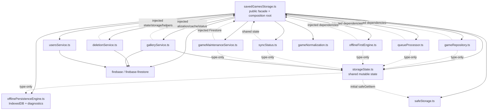

# Storage subsystem architecture

## Scope

This document describes the current storage implementation in `src/utils/` as inspected on 2026-10-31. It covers `savedGamesStorage`, `storageState`, `gameRepository`, `queueProcessor`, `offlineFirstEngine`, `syncStatus`, `galleryService`, `deletionService`, and `gameMaintenanceService`, plus supporting modules they use directly (`offlinePersistenceEngine`, `safeStorage`, `gameNormalization`, `usersService`, and `firebase`). It records current behavior and boundaries; it does not prescribe or implement a refactor.

## Module responsibilities

| Module | Current responsibility | Direct dependencies / notable I/O |
|---|---|---|
| `savedGamesStorage.ts` | Public storage facade and composition root. Re-exports normalization utilities, creates the storage services, exposes wrappers for save/update, queue, sync status, gallery, deletion, and repair APIs, and forwards user/activity APIs. It also retains connection monitoring, `sanitizeForFirestore`, `buildFirestorePayloadFromItem`, `syncTemporaryLocalCache`, admin detection, ID tombstone persistence, and several helpers. | `firebase/firestore`, `firebase`, `safeStorage`, `offlinePersistenceEngine`, `storageState`, `gameNormalization`, all service factories, `usersService`. Starts the connection monitor/bootstrap when `window` exists. |
| `storageState.ts` | Owns the shared mutable state object used across storage services: memory store, bootstrap/sync flags, queue, locks, timers, observable sync state and subscribers, tombstone sets, Firestore subscription, sorted cache, auto-heal tracking, and reorganization lock. Loads the deleted/cleared ID sets during module initialization. | `safeGetItem` for initial set hydration; type-only state types from `offlinePersistenceEngine`. |
| `gameRepository.ts` | Implements `saveGameUnified` and `updateGameUnified`, including normalization, local persistence, gallery/cache updates, queue insertion, diagnostics, duplicate cleanup, and starting/waiting briefly for queue work. Contains the private document-ID resolution helper. | Dependencies are injected in groups: normalization, shared state/storage operations, gallery, queue, diagnostics, Firestore duplicate deletion. Uses the passed `storageState` reference. |
| `queueProcessor.ts` | Implements sequential queue processing and manual retry. Owns no queue state; operates on injected shared state. Applies retry delays, writes queue tasks, invokes Firestore verification, updates IndexedDB/gallery/diagnostics/status, and schedules retry/reprocess timers. | Injected shared state, sync-status service, Firestore writer callback, IndexedDB operations, gallery callback, diagnostics, retry policy, normalization/time helpers. It does not import Firestore or the facade. |
| `offlineFirstEngine.ts` | Implements bootstrap/hydration and the set/read/verify Firestore writer. The Firestore payload builder is not in this module: it is injected from the facade. | Injected shared state, IndexedDB/storage migration operations, normalization/sorting, sync-status and queue callbacks, Firestore APIs and timeout wrapper, storage keys. Uses the passed state reference. |
| `syncStatus.ts` | Computes queue diagnostics and owns the operations that update, read, and notify subscribers of the observable sync status. The mutable data itself remains in `storageState`. | Receives the shared state reference. No Firestore or IndexedDB calls. |
| `galleryService.ts` | Manages the shared Firestore saved-games listener, gallery subscription/read access, and cache updates/notifications. Handles remote merge, tombstones, pending local saves, misplaced-game auto-healing, and sorted cache updates. | Receives storage, normalization, sorting, cache, and status callbacks; **currently imports `db`, Firestore APIs, and `storageState` directly**. Firestore listener performs reads and can issue `setDoc`/`deleteDoc`; IndexedDB operations are injected. |
| `deletionService.ts` | Implements permanent deletion, batch deletion, right-sequence clearing, deletion by day/operator, gallery clearing, and local sequence-bar purge. | Receives state and most policy/storage helpers; **currently imports Firestore APIs and `db` directly**. Mutates tombstones, queue and memory state, persists to IndexedDB, updates UI subscribers/cache, and deletes Firestore documents. |
| `gameMaintenanceService.ts` | Implements `reorganizeAndHealAllStoredGames`: scans Firestore games, corrects misplaced metadata, updates memory/cache, persists corrected games locally, and emits the saved-games update event. | Receives shared state, Firestore operations, IndexedDB operations, normalization/sorting, and cache callback through injection. |

### Supporting modules used by these responsibilities

- `offlinePersistenceEngine.ts` contains IndexedDB stores and operations (`games_store`, `save_queue_store`, diagnostic logs, KV cache), plus the retry delay constant and diagnostic log persistence. `savedGamesStorage.ts` imports its persistence functions and passes them to service factories. `storageState.ts` imports some of its types only.
- `safeStorage.ts` provides safe key/value storage and migration/hydration used by the facade, `storageState`, and injected services.
- `gameNormalization.ts` provides game ID, date, folder, line-count, sequence sorting, and lightweight-item normalization utilities. The facade re-exports part of this module and injects utilities into services.
- `usersService.ts` provides Firestore subscriptions for users/activity and a user-field update. The facade forwards those APIs and supplies `sanitizeForFirestore` for user updates.

## Dependency graph

Solid arrows represent runtime imports. Dotted arrows represent type-only imports or injected calls; they are not imports from the callee module.

The service factories are composed in `savedGamesStorage.ts`. The service modules do not import the facade. `galleryService.ts` and `deletionService.ts` currently import Firestore directly; the other service modules use injected Firestore or writer functions where applicable. `galleryService.ts` currently imports the shared `storageState` value directly, while most other services receive it through their factory dependencies (and `syncStatus` receives it explicitly).

## Shared state ownership

`storageState.ts` is the declared owner of the shared mutable storage state. Its singleton object contains:

- `firestoreGamesMemoryStore`: `Map<string, GameSequenceItem>`; in-memory saved-game records.
- `hasSyncedWithFirestore`, `hasBootstrappedIndexedDB`, `connectionMonitorInitialized`: lifecycle/connection flags.
- `syncQueueMap`: queued save tasks.
- `isProcessingQueue`, `queueLockAcquiredAt`, `reprocessRequested`, `retryTimerHandle`: queue lock and scheduling state.
- `currentSyncState` and `syncStatusSubscribers`: observable sync state and its subscribers.
- `deletedGameIdsSet`, `clearedSequenceBarIdsSet`: deletion/sequence-clear tombstones.
- `inFlightAutoHealIds`: IDs whose metadata repair is currently being written.
- `savedGamesSubscribers`, `activeFirestoreUnsubscribe`: gallery subscription state.
- `cachedSortedGames`: current sorted gallery cache.
- `isReorganizationRunning`: repair-operation lock.

Services that accept `state` work on the same object reference supplied by the facade; the repository, queue processor, offline-first engine, sync-status service, deletion service, and maintenance service do not make their own shared-state maps or sets. The gallery service reads and mutates the imported `storageState` singleton directly. `storageState.ts` creates its initial tombstone sets from stored values; that is initialization of the owner, not a per-service copy.

## Operational flows

### Bootstrap

1. Importing `savedGamesStorage.ts` creates the service instances around the singleton `storageState` and wires their injected callbacks.
2. In a browser, `initConnectionMonitor()` registers `online` and `offline` listeners, starts a five-second watchdog interval, and triggers `bootstrapOfflineFirstEngine()` without awaiting it.
3. Bootstrap returns early if it has already run or there is no `window`; otherwise it marks the bootstrap flag before entering the guarded work.
4. It awaits `migrateAndHydrateStorageFromIndexedDB()`.
5. It reads the deleted-game and cleared-sequence keys and adds valid string IDs to the existing tombstone sets.
6. It awaits all local games from IndexedDB, filters tombstoned games (requesting deletion without awaiting), normalizes remaining records, and fills missing entries in the shared memory map.
7. If local games were present, it sorts the shared memory values, updates `cachedSortedGames`, and notifies saved-game subscribers.
8. It awaits pending queue tasks from IndexedDB, restores them into the shared queue as pending with a fresh retry time, normalizes their games, and updates the memory map.
9. It calls `updateSyncStatus({})`, then starts queue processing without awaiting if the queue is nonempty.
10. Bootstrap errors are logged and contained by its catch block.

### Save

`saveGameUnified(item)` delegates from the facade to `gameRepository`.

1. Validate input and initialize the connection monitor.
2. Resolve date, operator folder, mode, round, canonical/existing document ID, line count, timestamp, and the normalized saved-game item.
3. Remove matching tombstones from the shared sets and persist those sets when needed.
4. Await the local IndexedDB game write, then update the gallery/memory cache through the gallery callback.
5. Record the local-save diagnostic asynchronously (without awaiting it).
6. Construct a pending queue task, insert it in the shared queue map, await queue-task persistence in IndexedDB, and update sync status.
7. Clean duplicate document IDs: remove from memory, request IndexedDB deletion without awaiting, and request Firestore deletion with a swallowed rejection.
8. Start `processSaveQueue()`, race it against a 1.2-second timeout, await the race, then clear the timeout in `finally`.
9. Derive `verified` from whether the task is absent from the shared queue and return the latest in-memory game or the normalized local game.

`updateGameUnified` delegates to `saveGameUnified`. The compatibility API `saveGameToFirestoreAndGallery` awaits `saveGameUnified`.

### Synchronization

1. The queue processor checks the shared lock. If another run owns it, the processor either releases an expired lock or sets `reprocessRequested` and returns.
2. For a nonempty queue, it acquires the lock, records its timestamp, and processes ready tasks sequentially. Each loop refreshes the lock timestamp and selects the earliest eligible task by retry count and enqueue time.
3. Before writing, it marks the task as syncing in the shared queue and updates observable status.
4. It calls the injected Firestore writer (`offlineFirstEngine.writeAndVerifyGameInFirestore`). That writer builds its document reference and payload via injected dependencies, awaits `setDoc` with an 8-second timeout, then awaits `getDoc` with a 6-second timeout and validates the returned document fields.
5. On verified success, the queue removes the task from memory, awaits its removal from IndexedDB, awaits saving the verified game to IndexedDB, updates the gallery, records diagnostics, and updates sync status.
6. On failure, it calculates the retry delay, marks the task as error in the shared queue, awaits queue persistence and diagnostic persistence, and updates sync status.
7. In `finally`, it releases the lock, normalizes any lingering syncing task states, updates status, schedules the next retry timer if tasks remain, and schedules a short reprocess timer if requested and a task is ready.

`syncStatus.ts` calculates status from the shared queue, memory store, tombstones and queue-lock state. It updates `currentSyncState` and notifies subscribers; it does not persist games or contact Firestore.

### Deletion

1. Public deletion methods delegate to `deletionService`; admin checks gate the destructive operations.
2. The service resolves IDs and matching game records from the gallery, shared memory, IndexedDB, and, where required, Firestore.
3. `executeBatchGameDeletion` immediately adds tombstones, removes queue entries and memory records, persists deleted IDs, purges local sequence-bar entries, updates sync status/cache/subscribers, and dispatches the saved-games update event.
4. It then uses `Promise.allSettled` over IDs. For each ID it awaits queue-task removal, awaits game removal from IndexedDB, and then attempts the Firestore document deletion; Firestore errors are logged while the tombstone remains.
5. Other deletion entry points mark cleared-sequence IDs and clear sequence keys, gather matching items, then delegate to batch deletion for admins or notify the local UI path for non-admin sequence clearing.

### Repair / reorganization

1. `reorganizeAndHealAllStoredGames()` in the facade delegates to `gameMaintenanceService`.
2. The service uses `isReorganizationRunning` to prevent overlapping scans, awaits the Firestore `saved_games` query, then traverses `snap.docs` sequentially with `for...of`.
3. Tombstoned documents are removed from memory, scheduled for IndexedDB deletion without awaiting, and scheduled for Firestore deletion with a swallowed rejection.
4. Other documents are normalized. Misplaced records are written to Firestore with `setDoc` and merge semantics; after that write settles, a 3-second timer releases the in-flight auto-heal ID. The service then updates memory and awaits the IndexedDB write. Correctly placed records update memory only.
5. It sorts the memory store, updates `cachedSortedGames`, invokes the injected temporary-cache callback, dispatches the saved-games update event, and releases the reorganization lock in `finally`.

## Invariants to preserve

These are behavior and architecture constraints reflected by the current implementation:

1. **One shared mutable state owner:** all storage modules must work against the `storageState` singleton/reference; do not create service-local copies of its `Map`, `Set`, queue, subscriber collections, timers, or flags.
2. **The facade is the public storage entry point:** public saved-game APIs and compatibility exports remain on `savedGamesStorage.ts`; service implementations are composed behind it.
3. **No service-to-facade import:** the storage service modules do not import `savedGamesStorage.ts`. Preserve the acyclic direction from facade/composition root to services.
4. **Local-first saving:** persist the normalized game to IndexedDB before gallery cache/queue processing; queue task persistence and sync-status update occur before starting the queue.
5. **Sequential queue writes:** at most one queue pass owns the processing lock; ready tasks are processed sequentially. Preserve lock ownership/release, watchdog checks, `reprocessRequested`, timer placement, and retry timing.
6. **Firestore verification order:** build payload, `setDoc`, `getDoc`, then validate. Preserve timeout values, merge semantics, collection/document names, callbacks, and error/return behavior.
7. **Bootstrap order:** migration/hydration precedes tombstone hydration; local games precede pending queue restoration; status refresh precedes unawaited queue resumption.
8. **Deletion tombstones precede remote cleanup:** add tombstones and remove matching in-memory/queue state before IndexedDB and Firestore deletions, preventing listener-driven resurrection.
9. **Batch deletion semantics:** preserve the existing `Promise.allSettled` and per-ID sequence of queue removal → game removal → Firestore delete.
10. **Repair remains sequential:** preserve the `for...of` traversal and awaits, along with unawaited cleanup calls, `.finally()` behavior, and the 3-second release timer.
11. **Subscriber/cache consistency:** update the shared sorted cache and notify the existing subscriber sets through the same pathways and ordering used today.
12. **Persistence formats and keys:** preserve the existing collection names (`saved_games`, `users`, `activity_logs`), document paths, IndexedDB store names, local keys, and payload shape.
13. **Public compatibility:** preserve exported names, parameter types/defaults, return values, and compatibility aliases.

## Current architecture observations

- The facade is the composition root, but it also still contains meaningful implementation: the connection monitor/watchdog, Firestore payload builder, cache helper, admin check, tombstone persistence helpers, date validity helper, and user-update sanitizer call. It is therefore not yet a pure re-export-only facade.
- `galleryService.ts` imports the shared state singleton and Firebase directly. `deletionService.ts` imports Firebase directly. These facts should be accounted for when assessing future dependency-boundary or cycle risks; no service imports the facade in the current graph.
- `storageState.ts` has a type-only dependency on `offlinePersistenceEngine.ts`, and a runtime dependency on `safeStorage.ts` for initial tombstone hydration.
- `storageState.ts` is the owner of shared state, while `offlinePersistenceEngine.ts` separately owns IndexedDB database initialization, persistence implementations, and diagnostic log memory.
